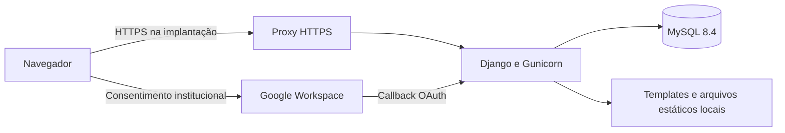
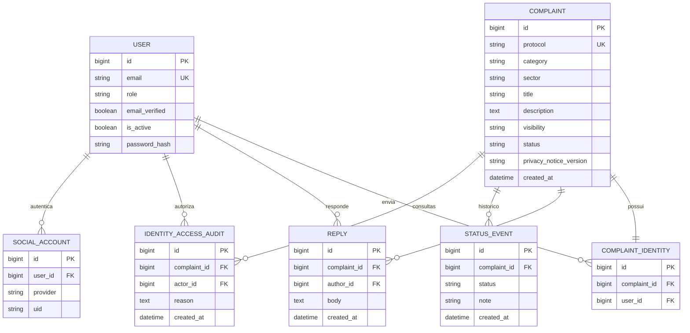

# Arquitetura da ouvidoria

## Estrutura

Monólito Django com templates renderizados no servidor, formulários, autenticação por sessão e ORM. O MySQL 8.4 é o banco principal. Não há API separada, SPA ou fila de processamento. Essa estrutura mantém os fluxos do TCC fáceis de executar e explicar.

O Compose disponibiliza a aplicação na interface local e mantém o banco na rede interna. O proxy HTTPS e a publicação pública pertencem à infraestrutura de implantação. O frontend usa CSS e JavaScript locais, sem dependência de fontes ou componentes externos.

## Perfis e autenticação

| Perfil | Permissões na aplicação |
| --- | --- |
| Aluno (`student`) | Enviar manifestações e acompanhar somente as próprias. |
| Ouvidoria (`ombudsman`) | Consultar, responder e alterar situações; ver identidade apenas de envios identificados. |
| Direção (`director`) | Permissões da ouvidoria e consulta excepcional de identidade sigilosa com justificativa, senha e auditoria. |

Contas precisam estar ativas; a área administrativa também exige e-mail confirmado. Perfis privilegiados são atribuídos por comando do servidor, nunca pelo cadastro público.

O `django-allauth` executa OAuth 2.0, incluindo a troca do código e validação do estado da sessão. O adapter institucional aplica regras aos dados autenticados do Google: domínio exato `camporeal.edu.br`, e-mail verificado e organização `hd=camporeal.edu.br`. O parâmetro da URL e um e-mail digitado pelo visitante não autenticam ninguém. Contas já vinculadas são revalidadas; a aplicação não associa automaticamente contas locais por coincidência de e-mail.

Novas contas Google recebem o perfil de aluno. `SOCIALACCOUNT_ONLY` bloqueia os caminhos alternativos de senha e redefinição do allauth. O formulário local próprio é permitido apenas no desenvolvimento. A senha da direção confirma a consulta sensível; o acesso normal de produção é Google.

## Dados

O diagrama apresenta as entidades relevantes; as tabelas de permissões, cache, sessões e e-mails do Django/allauth não foram detalhadas. As migrações de cada app definem o esquema efetivo.

`ComplaintIdentity` separa a relação com o aluno dos dados operacionais. Isso reduz exposição acidental em telas comuns, mas não criptografa a identidade nem impede o acesso técnico de quem administra o banco.

O protocolo combina ano e aleatoriedade criptográfica e tem restrição de unicidade no banco. Ele não é senha: o acompanhamento sempre filtra pela conta autenticada, mesmo quando recebe um protocolo válido de outro aluno.

## Fluxos

1. O aluno acessa pelo Google institucional e escolhe tipo, setor, assunto, descrição e modalidade de identificação.
2. O servidor valida os campos e registra manifestação, identidade reservada e primeiro evento de situação em uma transação.
3. O aluno recebe o protocolo na tela e acompanha o histórico em sua conta.
4. A ouvidoria responde e escolhe a situação; resposta e evento ficam no histórico.
5. O aluno consulta a resposta pelo acompanhamento autenticado.

Situações: **Recebida**, **Em análise**, **Respondida** e **Concluída**. Esta versão não implementa distribuição automática, prazos legais, SLA, encaminhamento externo ou anexos.

Nas manifestações sigilosas, o DTO entregue às telas administrativas comuns não contém objeto de usuário ou identidade reservada. Nas identificadas, nome e e-mail ficam disponíveis à equipe autorizada.

Para consultar uma identidade sigilosa, a direção envia `POST` com justificativa e senha. O servidor valida o perfil e a confirmação, grava `IdentityAccessAudit` e só então apresenta a identidade naquela resposta, marcada para não armazenamento em cache. A identificação não reaparece em um `GET` posterior. A direção consulta o histórico de acessos do atendimento.

A auditoria registra quem consultou, quando e por quê; a faculdade precisa definir quais circunstâncias justificam o acesso. O registro está no mesmo banco e não é uma trilha externa imutável contra administradores da infraestrutura.

## Proteções e limites

- Sessões HTTP-only, CSRF, escape dos templates e consultas pelo ORM.
- Autorização no servidor por perfil e propriedade, independentemente de botões visíveis.
- Hashes de senha e confirmação sensível sem senha padrão.
- Limites de tentativas usando cache compartilhado no banco; restrições adicionais podem ser aplicadas no proxy.
- Páginas privadas sem cache e consulta de identidade com `no-store`.
- Sem rota do Django Admin genérico ou cadastro público de perfis privilegiados.
- Segredos fora do Git e banco interno ao Compose; HTTPS é responsabilidade da implantação.

**Sigilo não é anonimato absoluto.** Todos os envios exigem autenticação. A direção pode consultar a autoria com registro, e administradores técnicos têm acesso ao armazenamento. O próprio texto livre pode permitir inferir quem escreveu; a interface orienta o aluno antes do envio.

Não há retenção automática, anonimização definitiva, criptografia de campos com chaves externas, MFA própria ou auditoria fora do banco. Antes de dados reais, a faculdade precisa aprovar operação, acessos, prazo de retenção, descarte e tratamento de dados pessoais. O Google pode aplicar suas políticas próprias de autenticação institucional.

## Validação

Os testes exercitam persistência e requisições Django: envio, propriedade, autorização, respostas, sigilo, auditoria e regras Google. Os testes OAuth controlam as claims para validar a política local; consentimento e callback reais dependem das credenciais institucionais e do domínio configurado.

`scripts/check.sh` usa MySQL descartável separado do banco da aplicação. Uma execução apenas em SQLite não comprova o requisito MySQL. `scripts/dev.sh` prepara banco, migrações, cache compartilhado e serviços para desenvolvimento. Consulte o README para instalação e demonstração.
